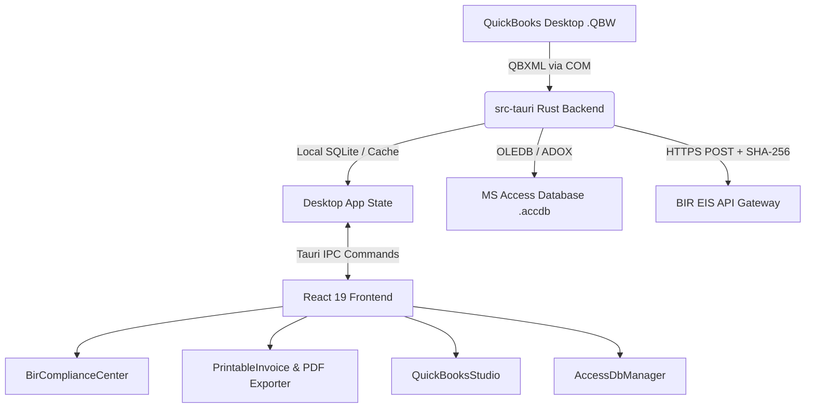

# BIR EIS & QuickBooks E-Invoicing Compliance System

[](https://github.com/Itsmeeedanhil/E-invoicing.git)
[](https://v2.tauri.app/)
[](https://react.dev/)
[](https://www.rust-lang.org/)
[](https://vitejs.dev/)
[](https://tailwindcss.com/)

An enterprise-grade desktop compliance application built with **Tauri 2 (Rust)**, **React (TypeScript + Vite + Tailwind CSS)**, **QuickBooks Desktop SDK (QBSDK / QBXML COM)**, and **Local MS Access Database (`.accdb`)** storage. 

Engineered specifically to comply with Philippine tax laws and regulations:
- **BIR Revenue Regulations (RR) No. 8-2022** & **RR No. 9-2021** (Electronic Invoicing / Electronic Receipting System - **EIS**)
- **Tax Reform for Acceleration and Inclusion (TRAIN Law - RA 10963)**
- **Ease of Paying Taxes Act (EOPT - RA 11976)**
- **BIR Computerized Accounting System (CAS)** standards (RMO 29-2019 / RMC 10-2020)

---

## 📋 Table of Contents

- [Overview & Legal Background](#-overview--legal-background)
- [Key Features](#-key-features)
- [Multi-Page Print & PDF Export Architecture](#-multi-page-print--pdf-export-architecture)
- [System Architecture & Tech Stack](#-system-architecture--tech-stack)
- [Quick Start Guide](#-quick-start-guide)
- [QuickBooks Desktop Integration Setup](#-quickbooks-desktop-integration-setup)
- [BIR Compliance & System Configuration](#-bir-compliance--system-configuration)
- [Tax Classification & Calculation Engine](#-tax-classification--calculation-engine)
- [Project Structure](#-project-structure)
- [Git & Push Workflow](#-git--push-workflow)
- [License](#-license)

---

## 🏛️ Overview & Legal Background

Under Philippine **BIR Revenue Regulations No. 8-2022** and **No. 9-2021**:
- Taxpayers engaged in export of goods/services, e-commerce, and Large Taxpayers Service (LTS) are required to issue electronic receipts/invoices and transmit sales data in real-time or within 3 calendar days to the BIR EIS portal.
- Taxpayers operating Computerized Accounting Systems (CAS) must maintain strict audit trails, sequential invoice numbering without gaps, 12% VAT calculations, Senior/PWD statutory exemption rules, and SHA-256 digital payload hashing.

> [!NOTE]
> The official Philippine electronic invoicing system is named **BIR EIS (Electronic Invoicing System)**, not "IES".

---

## 🚀 Key Features

### 1. BIR EIS Compliance & Validation Engine
- **TIN & Branch Validation**: Rigorous validation of 9 and 12-digit Philippine Tax Identification Numbers (`XXX-XXX-XXX-XXXXX`) with branch codes.
- **Tax Classifications**:
  - **12% VATable Sales**: Net sales derived dynamically from VAT-inclusive and VAT-exclusive line items.
  - **0% VAT-Exempt Sales**: Statutory exempt items, agricultural goods, and Senior Citizen / PWD purchases.
  - **0% Zero-Rated Sales**: Direct export sales and PEZA-registered ecozone enterprises.
  - **Non-VAT & Creditable Withholding Tax (BIR Form 2307)**: Automated 1% (Goods) and 2% (Services) expanded withholding tax calculation.
  - **Senior Citizen & PWD 20% Statutory Discount**: Automated deduction with OSCA/PWD ID recording and VAT exemption.
- **Canonical BIR EIS JSON Schema**: Generates standard BIR EIS JSON payload conforming to BIR EIS specifications.
- **SHA-256 Anti-Tampering Hash**: Cryptographic hash computed for every invoice and batch payload to ensure tamper-proof electronic storage.
- **Batch Transmission Engine**: Generates official BIR Acknowledgement Numbers (`EIS-ACK-YYYYMMDD-XXXXX`) with full raw JSON request and response audit logs.

### 2. QuickBooks Desktop SDK (QBSDK) Integration
- **Direct Windows COM Bridge**: Communicates with QuickBooks Desktop Pro, Premier, and Enterprise using `QBXMLRP2.RequestProcessor`.
- **QBXML Query Automation**: Extracts customer details, item codes, line item quantities, tax codes, and amounts directly from company files (`.QBW`).
- **Live / Simulated Dual-Engine**:
  - **Live Mode**: Directly queries open QuickBooks Desktop company instances.
  - **Simulator Mode**: Allows development, testing, and offline audits without needing an active QuickBooks license.
- **Visual Tax Code Mapping Studio**: Map QuickBooks sales tax codes (`TAX`, `NON`, `ZERO`, `SENIOR`, `EWT_1`, `EWT_2`) directly into BIR EIS tax categories.

### 3. MS Access Database (`.accdb` / `.mdb`) Local Data Store
- **Windows OLEDB / ODBC Integration**: Uses `Microsoft.ACE.OLEDB` / `Microsoft.Jet.OLEDB` drivers.
- **Automated Schema Provisioning**:
  - `tbl_Invoices`: Master sales records with BIR EIS validation score, transmission status, and SHA-256 digest.
  - `tbl_InvoiceItems`: Detailed line items, descriptions, quantities, unit prices, and tax types.
  - `tbl_BIR_Transmissions`: Complete history of EIS batch transmissions and BIR gateway responses.
  - `tbl_CAS_AuditTrail`: Immutable chronological audit logs recording user actions and system changes.
  - `tbl_TaxMappings`: QuickBooks tax code mapping rules.
- **1-Click Database Initializer & Exporter**: Creates database tables and exports synchronized records with one click.

### 4. Official BIR CAS Printable Sales Invoice & PDF Export
- **CAS / PTU Compliant Layout**: Includes required BIR header, seller business style, CAS Permit to Use (PTU) number, ACCN number, POS machine ID, validity clause, and customer details.
- **Anti-Fraud QR Code**: Scannable QR code encoding seller TIN, buyer TIN, invoice number, amount, date, and SHA-256 hash.
- **Smart Multi-Page Synchronization**: Matches browser print pagination with PDF exports (16 line items on Page 1; 8 line items + totals on Page 2+).

---

## 🖨️ Multi-Page Print & PDF Export Architecture

To comply with official BIR CAS continuous forms and A4 sheet printing standards:

```
PAGE 1 LAYOUT:
+-------------------------------------------------------------+
|  [Header & Seller Profile: Name, TIN, Address, CAS PTU]     |
|  [Buyer Details: Customer Name, TIN, Address, Style, Date]  |
+-------------------------------------------------------------+
|  Table: Line Items 1 to 16                                  |
|  - Item Name & Description | Qty | Unit Price | Tax | Amount|
+-------------------------------------------------------------+
|  (If > 16 items: Continuation notice & Master Page Footer)  |
+-------------------------------------------------------------+

PAGE 2+ LAYOUT:
+-------------------------------------------------------------+
|  [Page Header: Continuation Header & Invoice Reference]    |
+-------------------------------------------------------------+
|  Table: Line Items 17 to 24 (or remaining)                  |
+-------------------------------------------------------------+
|  [BIR Tax Summary Breakdown Box & Net Amount Payable]       |
|  - VATable (12%), VAT-Exempt, Zero-Rated, Non-VAT, EWT      |
+-------------------------------------------------------------+
|  [Signatures: Prepared By, Checked By, Received By]         |
|  [Mandatory BIR CAS Accreditation & 5-Year Validity Notice] |
+-------------------------------------------------------------+
```

---

## 🛠️ System Architecture & Tech Stack



- **Desktop Framework**: [Tauri v2](https://v2.tauri.app/) (Rust 1.80+)
- **Frontend**: React 19 + TypeScript + Vite + Tailwind CSS v4
- **Icons & Styling**: Lucide React + Plus Jakarta Sans + JetBrains Mono
- **Databases**: Local SQLite + Microsoft Access (`.accdb`) via OLEDB
- **SDK Bridge**: QuickBooks Desktop SDK 13.0/16.0 (`QBXMLRP2.RequestProcessor`)
- **PDF Generation**: `html2canvas` + `jspdf` with synchronized page chunking

---

## 📦 Quick Start Guide

### 1. Prerequisites
- **Node.js**: v18.0 or newer (tested on Node v20/v22)
- **Rust & Cargo**: 1.80 or newer ([Install Rust](https://rustup.rs/))
- **Operating System**: Windows 10 or Windows 11 (64-bit)
- **C++ Build Tools**: Visual Studio 2022 C++ Build Tools (required by Tauri on Windows)

### 2. Installation
```powershell
# Clone the repository
git clone https://github.com/Itsmeeedanhil/E-invoicing.git

# Navigate to project directory
cd E-invoicing

# Install NPM dependencies
npm install
```

### 3. Development Run
```powershell
# Launch the full Tauri desktop application in development mode:
npm run tauri dev

# Or run the Vite web preview alone in your browser:
npm run dev
```

### 4. Build Standalone Desktop Installer (`.exe` / `.msi`)
```powershell
npm run tauri build
```
The compiled release installer will be generated in `src-tauri/target/release/bundle/msi/`.

---

## 🔌 QuickBooks Desktop Integration Setup

1. Open **QuickBooks Desktop** and open your `.QBW` company file.
2. Launch **BIR EIS E-Invoicing**.
3. In the left navigation, click on **QuickBooks Studio**.
4. Click **Test Live Connection**.
5. When QuickBooks displays the **Application Certificate** prompt:
   - Select *"Yes, whenever this QuickBooks company file is open"*.
   - Click **Continue** and **Done**.
6. Click **Sync Invoices from QuickBooks** to import and recalculate invoices into BIR tax compliance format.

---

## ⚙️ BIR Compliance & System Configuration

Navigate to **Settings** (`BIR Compliance & System Configuration`) to configure:

### Section 1: BIR Taxpayer / Seller Profile
- **Registered Business Name**: Legal business name as registered in BIR Form 2303.
- **Trade / Doing Business As Name**: Commercial brand or operating name.
- **Business Line / Style**: Nature of business.
- **Taxpayer TIN**: 9-digit or 12-digit TIN (`123-456-789-00000`).
- **Branch Code**: 5-digit code (`00000` for Head Office).
- **Registered Address & RDO Code**: Revenue District Office code (e.g. `047`).
- **VAT Status**: Toggle VAT-Registered (12%) or Non-VAT.

### Section 2: BIR CAS Permit & EIS Credentials
- **CAS Permit to Use (PTU) #**: Permit issued by BIR CAS National / Regional Office.
- **ACCN Number**: Acknowledgment Certificate Control Number.
- **POS / Machine ID**: Terminal MIN (e.g. `POS-01-MKT`).
- **Permit Valid Until**: 5-year validity date.
- **BIR EIS API Gateway Endpoint**: `https://eis-cert.bir.gov.ph/api/v1/invoices`
- **EIS Client App ID**: Client identifier from BIR EIS Developer Portal.
- **EIS Client Secret / API Key**: Secret authentication key (with show/hide security toggle).
- **EIS Environment Mode**: `Sandbox` (Testing) or `Production` (Live transmission).

### Section 3: Integration Paths & Database Locations
- **QuickBooks Company File Path**: Full path to `.QBW` file.
- **MS Access Local Database File**: Full path to `.accdb` file.
- **Auto-Sync Toggle**: Automatically sync invoices on application launch.

---

## ⚖️ Tax Classification & Calculation Engine

| Tax Classification | Rate | Formula | Regulatory Reference |
| :--- | :---: | :--- | :--- |
| **VATable Sales (12%)** | 12% | `Vatable Sales = Gross / 1.12`<br>`Output VAT = Vatable Sales × 0.12` | NIRC Sec. 106 & 108 |
| **VAT-Exempt Sales** | 0% | `Output VAT = ₱0.00` | NIRC Sec. 109 |
| **Zero-Rated Sales** | 0% | `Output VAT = ₱0.00` | NIRC Sec. 106(A)(2) / PEZA |
| **Senior Citizen / PWD** | -20% | `Discount = Gross × 0.20`<br>`Net = Gross - Discount (VAT-Exempt)` | RA 9994 / RA 10754 |
| **Creditable Withholding (2307)** | 1% or 2% | `EWT = Net Sales × Withholding Rate` | RR 2-98 as amended |

---

## 📂 Project Structure

```
E-invoicing/
├── .github/                     # GitHub workflows and actions
├── src-tauri/                   # Rust Backend (Tauri v2)
│   ├── capabilities/            # Tauri security permissions
│   ├── icons/                   # Multi-resolution application icons
│   ├── scripts/                 # PowerShell QuickBooks COM bridge
│   ├── src/
│   │   ├── access_bridge.rs     # MS Access (.accdb) OLEDB connector
│   │   ├── bir_eis.rs           # BIR EIS tax calculation, SHA-256 & validation
│   │   ├── commands.rs          # Tauri IPC command handlers
│   │   ├── db.rs                # SQLite storage & CAS audit trail
│   │   ├── models.rs            # Rust DTO structs and models
│   │   ├── quickbooks.rs        # QBSDK COM / QBXML processor
│   │   ├── lib.rs               # Application runtime setup
│   │   └── main.rs              # Application binary entry
│   ├── Cargo.toml               # Rust package dependencies
│   └── tauri.conf.json          # Tauri configuration & window metadata
├── src/                         # Frontend Application (React + TypeScript)
│   ├── components/
│   │   ├── AccessDbManager.tsx  # MS Access database viewer & export
│   │   ├── AuditLogView.tsx     # Immutable CAS audit trail log
│   │   ├── BirComplianceCenter.tsx # Batch transmission & invoice list
│   │   ├── DashboardView.tsx    # BIR KPIs, VAT summary, quick actions
│   │   ├── Header.tsx           # Status bar & connection indicators
│   │   ├── InvoiceDetailModal.tsx # Invoice tax breakdown inspector
│   │   ├── PrintableInvoice.tsx # Official BIR CAS invoice printing engine
│   │   ├── QuickBooksStudio.tsx # QBSDK COM connection & Tax Code mapping
│   │   ├── SettingsView.tsx     # BIR Seller, PTU, ACCN & EIS setup
│   │   ├── Sidebar.tsx          # Navigation sidebar
│   │   ├── TransmissionModal.tsx # BIR EIS transmission receipt modal
│   │   └── UserManualView.tsx   # Built-in searchable user manual
│   ├── services/
│   │   └── api.ts               # Frontend IPC bridge to Rust backend
│   ├── types/
│   │   └── index.ts             # TypeScript interfaces
│   ├── utils/
│   │   ├── exportUtils.ts       # HTML2Canvas + jsPDF multi-page export
│   │   └── toast.ts             # Non-intrusive alert toasts
│   ├── App.tsx                  # Master application component
│   ├── index.css                # Tailwind CSS v4 & print CSS rules
│   └── main.tsx                 # DOM mounting point
├── public/                      # Static branding assets & favicon
├── .gitignore                   # Git ignore patterns
├── package.json                 # Node dependencies and build scripts
├── README.md                    # System documentation
├── tsconfig.json                # TypeScript compiler configuration
├── USER_MANUAL.md               # User operational manual
└── vite.config.ts               # Vite bundler configuration
```

---

## 🐙 Git & Push Workflow

To push updates to your GitHub repository:

```powershell
# 1. Check current status
git status

# 2. Stage changes
git add .

# 3. Commit changes
git commit -m "docs: update comprehensive README and BIR EIS compliance documentation"

# 4. Push to main branch
git push -u origin main
```

---

## 📄 License

This software is licensed under the **MIT License**. See `LICENSE` for details.
Designed and compliant for Philippine businesses operating under BIR EIS and CAS requirements.
